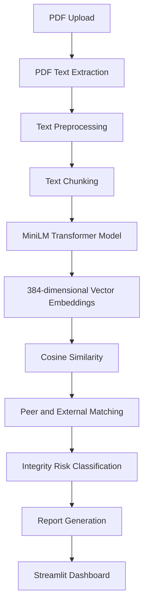

# AI-Powered PDF Plagiarism Detection Engine

An intelligent PDF plagiarism detection system built using
Python, Natural Language Processing, pretrained transformer
models, vector embeddings and cosine similarity.

The application provides an interactive Streamlit dashboard
for detecting exact duplication, paraphrased content and
semantic similarities across PDF documents.

## Project Objectives

- Detect exact and semantic plagiarism.
- Identify paraphrased content.
- Compare multiple PDF documents.
- Detect similarities against an external reference corpus.
- Generate explainable plagiarism reports.
- Provide an interactive browser-based application.

## Features

- Multiple PDF file uploads
- Automatic PDF text extraction
- Natural Language Processing
- Text normalization and chunking
- MiniLM transformer model
- 384-dimensional vector embeddings
- Cosine similarity search
- Exact duplication detection
- Semantic plagiarism detection
- Paraphrase detection
- External reference matching
- Configurable similarity threshold
- Experimental AI content indicator
- Integrity risk classification
- Interactive Streamlit dashboard
- Similarity charts
- Side-by-side matching evidence
- PDF page number tracking
- JSON and ZIP report downloads
- Execution logs
- Empty PDF handling
- Automated testing

## System Architecture



## Technology Stack

| Technology | Purpose |
|---|---|
| Python | Core programming language |
| Streamlit | Interactive web frontend |
| PyMuPDF | PDF text extraction |
| PyTorch | Model inference |
| Sentence Transformers | Semantic embeddings |
| MiniLM-L6-v2 | Pretrained transformer model |
| NumPy | Vector calculations |
| Scikit-learn | Similarity and evaluation |
| Pandas | Data processing |
| PyArrow | Table serialization |
| Pytest | Automated testing |
| Git and GitHub | Version control |

## AI Model

Model: sentence-transformers/all-MiniLM-L6-v2

- Architecture: Transformer encoder
- Embedding dimensions: 384
- Model type: Pretrained sentence embedding model
- Inference device: CPU
- Similarity metric: Cosine similarity
- Default similarity threshold: 0.70

The project uses pretrained model inference rather than
training or fine-tuning a model from scratch.

## Project Structure

```
submission-integrity-engine-web/
├── app.py
├── run_integrity_check.py
├── evaluate.py
├── generate_samples.py
├── requirements.txt
├── requirements-web.txt
├── requirements-macos-intel.txt
├── README.md
├── EVALUATION.md
├── src/
│   ├── __init__.py
│   ├── extractors.py
│   ├── chunking.py
│   ├── embeddings.py
│   ├── ai_detector.py
│   └── reporter.py
├── sample_submissions/
├── reference_data/
├── reports/
└── tests/
    └── test_pipeline.py
```

## How to Run This Project

### 1. Clone the Repository

```bash
git clone -b pdf-only https://github.com/MAARGUBULhaque/submission-integrity-engine-web.git
cd submission-integrity-engine-web
```

### 2. Create Virtual Environment

Python 3.11 is recommended.

```bash
python3 -m venv .venv
```

### 3. Activate Virtual Environment

macOS and Linux:

```bash
source .venv/bin/activate
```

Windows:

```bash
.venv\Scripts\activate
```

### 4. Install Dependencies

```bash
python -m pip install -r requirements-web.txt
```

The dependency versions are based on the development
environment using Python 3.11.3 on macOS Intel.
Other platforms may require adjustments.

### 5. Start the Application

```bash
python -m streamlit run app.py
```

Open the local URL displayed in the terminal,
normally http://localhost:8501.

### 6. Analyze PDF Documents

1. Select Upload files or Use sample dataset.
2. Upload PDF documents.
3. Configure the similarity threshold.
4. Click Analyze Submissions.
5. Review the similarity results.
6. Examine matching passages and page references.
7. Download the generated reports.

Upload at least two PDFs for peer comparison.
A single PDF can be compared against external references.

The first execution may require an internet connection
to download the pretrained MiniLM model.

## Run the CLI Pipeline

```bash
python run_integrity_check.py --input_dir ./sample_submissions --output_dir ./reports --threshold 0.70
```

## Generate Synthetic Dataset

```bash
python generate_samples.py
```

## Evaluate Performance

```bash
python evaluate.py --reports ./reports
```

## Run Automated Tests

```bash
python -m pytest -q
```

## Synthetic Test Dataset

| File | Testing Scenario |
|---|---|
| 01_health.pdf | Original content |
| 02_copy.pdf | Exact duplication |
| 03_transit.pdf | Independent content |
| 04_farming.pdf | Independent content |
| 05_empty.pdf | Invalid file handling |
| 06_retail.pdf | Original content |
| 07_paraphrase.pdf | Semantic paraphrasing |
| 08_ai.pdf | Experimental AI indicator |
| 09_external.pdf | External reference matching |
| 10_library.pdf | Independent content |

## Evaluation Results

| Metric | Result |
|---|---:|
| Total PDFs | 10 |
| Valid PDFs | 9 |
| Skipped PDFs | 1 |
| Evaluated document pairs | 36 |
| True positives | 2 |
| True negatives | 34 |
| False positives | 0 |
| False negatives | 0 |
| Accuracy | 100% |
| Precision | 100% |
| Recall | 100% |
| F1 Score | 100% |
| Similarity threshold | 0.70 |

These results were measured on a small synthetic
development dataset and do not establish real-world
accuracy or generalization.

## Understanding the Results

Peer and external similarity percentages represent
matched word-position coverage at the configured
similarity threshold.

Individual matching passages have separate cosine
similarity scores.

High similarity does not independently prove plagiarism.
Human verification is required.

The AI content indicator is an uncalibrated mock
heuristic, not a validated AI authorship classifier.
It is not used for integrity risk classification.

## Changes from the Multimodal Version

### Removed

- DOCX processing
- MP4 processing
- Whisper speech recognition
- FFmpeg and audio processing requirements
- Cross-modal plagiarism detection
- Video timestamp reporting

### Updated

- PDF-only extraction engine
- PDF-only processing pipeline
- Streamlit upload configuration
- Dashboard title and model information
- Synthetic dataset with 10 PDFs
- Evaluation script
- Automated test suite
- Dependency configuration
- Evaluation reports
- Project documentation

### Retained

- MiniLM model
- Natural Language Processing
- Vector embeddings
- Cosine similarity
- Semantic plagiarism detection
- External reference matching
- Explainable reports
- Interactive Streamlit dashboard

## Limitations

- Supports text-based PDFs only.
- Scanned PDFs may require OCR.
- External matching uses a local reference corpus.
- Does not search the entire internet.
- AI content estimation is experimental.
- Similarity results require human verification.
- Evaluation is limited to synthetic data.
- The simplified dependency configuration has not
  yet been validated in a fresh environment.
- The application currently runs locally.

## Future Enhancements

- OCR for scanned PDF documents
- FAISS or HNSW vector indexing
- REST API integration
- Cloud deployment
- Database integration
- Authentication
- Parallel document processing
- Larger independent evaluation datasets

## AI Assistance Disclosure

AI assistance was used for code generation,
implementation guidance, debugging, dependency
troubleshooting and documentation.

The pretrained MiniLM model was integrated rather
than trained from scratch.

The application was executed locally, evaluated
against synthetic ground truth and demonstrated
through its Streamlit dashboard.

## Version Information

This PDF-only branch is a simplified derivative of
the original Multimodal Submission Integrity Engine.

The original multimodal implementation is preserved
separately and supports PDF, DOCX and MP4 submissions.

This simplified version is intended for learning,
portfolio demonstration and technical interview
preparation. It does not replace the original
multimodal assignment requirements.

## Author

Maargubul Haque Shamsi

GitHub: https://github.com/MAARGUBULhaque

